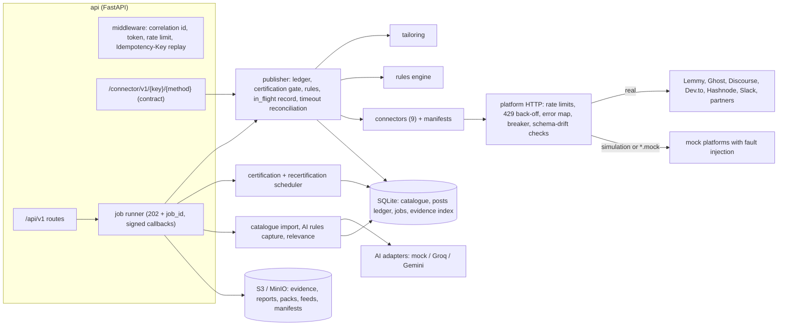

# IncuBrix Long-Tail Distribution

A containerised connector service that takes IncuBrix publishing beyond the big platforms, into forums, open networks, developer blogs, partner sites, team chats, video feeds and communities where a person must post.

It provides:

- **Nine connectors on one contract** (Appendix A): Discourse, Lemmy, Dev.to (any Forem), Ghost, a signed partner webhook, an assisted tier (a ready-to-post pack for a person), Hashnode, Slack app, and an MRSS video feed.
- **Configuration, not code:** one connector serves every instance. Adding forum number 41 is one catalogue row.
- **Posting rules checked before every post:** frequency cap, self-promotion, links, AI disclosure, automation permission and language. A post that breaks a rule is blocked or rescheduled, with the reason.
- **Certification:** a destination is used only after a real test post is published, its live URL confirmed, its status read, its metrics read where supported, and the post deleted, with stored evidence. A scheduler re-tests destinations before 30 days and demotes any that fail.
- **Safe retries:** the same idempotency key never creates a second post, even when the platform created the post but the answer timed out.
- **Catalogue tools:** CSV import (validate, de-duplicate, reachability, enrichment, relevance), AI rules capture that a person confirms, tailoring per destination, and a recommender.
- **Simulation mode:** mock platforms let everything run with no real accounts. `docker compose up` also starts a real local Lemmy and Ghost.

## Architecture



A request travels like this: `POST /api/v1/publications` → the middleware stores the Idempotency-Key → a job tailors the content for each destination (`app/tailoring.py`) → `app/publisher.py` checks the ledger, certification, connection, format limits and rules (`app/rules.py`), writes the attempt as `in_flight`, then calls the connector (`app/connectors/*.py`) through `app/connectors/http.py` → the result, its manifest and a download link come back on `GET /api/v1/jobs/{id}`.

| Path | What it is |
|---|---|
| `app/connectors/` | the contract (`base.py`), one module + one manifest YAML per connector, outbound HTTP (`http.py`) |
| `app/publisher.py` | the guarded publish path (idempotency, rules, reconciliation after timeouts) |
| `app/rules.py`, `app/tailoring.py` | the posting-rules engine and per-destination tailoring |
| `app/certification.py` | certification harness, evidence, recertification scheduler |
| `app/catalogue/` | catalogue store, CSV importer, AI rules capture and relevance |
| `app/recommender.py` | ranking destinations for a content item |
| `app/mocks/server.py` | mock platforms with fault injection (simulation mode) |
| `app/main.py`, `app/middleware.py`, `app/jobs.py` | HTTP API, idempotency, jobs |
| `tools/` | batch runner, local bootstrap, OpenAPI export, input generators |

## Setup (under 10 commands)

With Docker:

```bash
git clone <repo-url> incubrix-ps4 && cd incubrix-ps4
cp .env.example .env              # optional; works without it
docker compose up --build         # api :8080, Lemmy UI :1236, Ghost :2368, MinIO console :9001
```

The `bootstrap` container creates the Lemmy community and the Ghost integration, registers both and certifies every destination. Its log ends with one PASS or FAIL line per destination.

Without Docker (simulation mode, Python 3.11+):

```bash
python -m venv .venv && .venv/Scripts/activate        # Windows; use .venv/bin/activate elsewhere
pip install -r requirements-dev.txt
python -m app.serve                                   # http://localhost:8080/docs
```

## Tests and the batch runner

```bash
python -m pytest                                          # all tests, no keys, about 20 s
docker compose run --rm api python -m pytest              # the same inside the container
python -m tools.batch_runner --api http://localhost:8080 --input batch_inputs --out outputs
```

The 79 tests cover the contract for every connector, certification and recertification, every rule, every hard case, catalogue import (including 1,000 rows), rules capture, tailoring, the recommender, metrics, feeds and the Integration Standard. The end-to-end tests drive the full HTTP API.

`batch_inputs/` holds 17 inputs: one for each hard case plus the Core and Advanced features. Each input creates its own destinations, so runs never collide. The runner writes one JSON file per input and a `summary.json` to `outputs/batch-<timestamp>/`. Regenerate the inputs with `python -m tools.make_batch_inputs`.

## Using it

```bash
# add a forum (one row), certify it, publish to it
curl -X POST localhost:8080/api/v1/connections -H 'content-type: application/json' \
  -d '{"connector_key":"discourse","credentials":{"api_key_ref":"env:FORUM_KEY","api_username":"incubrix"}}'
curl -X POST localhost:8080/api/v1/destinations -H 'content-type: application/json' \
  -d '{"url":"https://forum.example.org","connector_key":"discourse","config":{"base_url":"https://forum.example.org"},"connection_id":"con_...","frequency_cap":"1/7d","self_promo_allowed":"no"}'
curl -X POST localhost:8080/api/v1/destinations/dst_.../certify
curl -X POST localhost:8080/api/v1/publications -H 'Idempotency-Key: launch-42' -H 'content-type: application/json' \
  -d '{"content":{"title":"...","body":"...","link":"https://incubrix.com/blog/x"},"destination_ids":["dst_..."]}'
curl localhost:8080/api/v1/jobs/job_...
```

The interactive API docs are at `/docs`. The contract is also served at `/connector/v1/{connector_key}/{method}` for IncuBrix's Connector Runtime; `destination` and `connection` may be full objects or `{"id": ...}` references.

### Hard cases: what the service does

| Situation | Behaviour |
|---|---|
| Publish times out, retried with the same key | The attempt is recorded as `in_flight` before the call. After a timeout the connector looks for the post (by title, idempotency metadata or partner lookup) and returns it, so there is never a second post. If the lookup cannot tell, it refuses to post blind. |
| 429 with a reset time | Waits for the reset when it is under `MAX_BACKOFF_S`; otherwise returns `PLATFORM_RATE_LIMIT` with `reset_at` and reschedules the post |
| Expired token | `CONNECTION_AUTH_EXPIRED`; the connection is marked expired, the destination paused and a ticket raised. `PATCH /connections/{id}` reconnects and resumes it. |
| Content rejected | `PLATFORM_CONTENT_REJECTED` with the platform's message |
| Too long / unsupported media | Tailoring cuts at a word boundary and drops unsupported media, with notes. `validate` reports field-level `DEST_SPEC_VIOLATION`s. |
| Second post inside a cap; promotion to a no-promotion community | Rescheduled to when the window frees up; blocked with the reason |
| Renamed API field | Schema-drift check fails the call, certification fails, the destination is demoted and excluded, a ticket and alert are raised, and any orphan post is cleaned up |
| CSV with duplicates, bad URLs, mixed languages | Row-by-row report: duplicate-of-row, error reasons, warnings, detected language |
| Partner revokes permission | 403 → connection `revoked`, destination paused, ticket raised |
| Non-English community; AI disclosure required | Disclosure line in the community's language, a language warning (or a block with `language_strict`); a missing disclosure is blocked |

Reproduce any of them on a mock-backed destination with `POST /api/v1/sim/faults` (`timeout_after_create`, `timeout`, `rate_limit`, `auth_expired`, `reject`, `rename_field`, `revoke`, `server_error`).

## Posting rules (catalogue columns)

| Column | Values |
|---|---|
| `frequency_cap` | `1/7d`, `2/day`, `1/week`, `3/30d`; empty means no cap |
| `self_promo_allowed` | `yes`, `no`, `limited` (one promotional post per 30 days), `limited:1/14d` |
| `link_policy` | `;`-joined: `any`, `none`, `one_link`, `no_shorteners`, `allowlist:a.com,b.org`, `canonical_only` |
| `disclosure_required` | `true`: AI-generated content must carry a disclosure line (tailoring adds one) |
| `automation_allowed` | `false`: native posting is blocked; use the assisted connector |
| `language` (+ `config.language_strict`) | the community's language; strict blocks posts in other languages |

Destinations get a level after certification: L0 catalogued only, L1 assisted, L2 bridged or feed, L3 native API (publish, status and delete tested), L4 native plus metrics.

## Settings

Every setting is an environment variable, listed with its default in [`.env.example`](.env.example). The main ones are `SIMULATION_MODE`, `API_TOKEN`, `SECRET_KEY`, `S3_*`, `AI_PROVIDER` (`mock`, `groq` or `gemini`) with its key and model, `HTTP_TIMEOUT_S`, `MAX_BACKOFF_S`, `RECERT_AFTER_DAYS` and `ALERT_WEBHOOK_URL`. There are no hard-coded paths or keys.

Connection credentials are stored encrypted with `SECRET_KEY`, or given as references such as `{"api_key_ref": "env:DISCOURSE_API_KEY"}`. They are never returned by the API and never logged: log lines are redacted.

## Error codes

Every error is `{"error": {"code", "message", "retryable", "details"}}`. `GET /api/v1/errors` lists the codes too.

<!-- generated from app/errors.py -->
**Shared connector codes (Appendix A)**

| Code | HTTP | Retry | Meaning |
|---|---|---|---|
| `DEST_SPEC_VIOLATION` | 422 | no | Content breaks the destination's format limits. |
| `DEST_RULE_FREQUENCY_CAP` | 409 | later | Frequency cap reached; reschedule after the cap window. |
| `CONNECTION_AUTH_EXPIRED` | 401 | after reconnect | Token expired or revoked; ask the owner to reconnect. |
| `PLATFORM_RATE_LIMIT` | 429 | yes | Platform rate limit; back off using its reset time. |
| `PLATFORM_QUOTA_EXHAUSTED` | 429 | next window | Daily quota used up; reschedule. |
| `PLATFORM_CONTENT_REJECTED` | 422 | no | Platform refused the content. |
| `PLATFORM_UNAVAILABLE` | 502 | yes | Platform unavailable; retry, stop after 5 consecutive failures. |
| `CONNECTOR_DISABLED` | 503 | no | Kill switch is on for this connector. |

**Service codes**

| Code | HTTP | Retry | Meaning |
|---|---|---|---|
| `VALIDATION_ERROR` | 400 | no | The request body or parameters are invalid. |
| `UNAUTHORIZED` | 401 | no | Missing or wrong API token. |
| `NOT_FOUND` | 404 | no | The resource does not exist. |
| `IDEMPOTENCY_KEY_CONFLICT` | 409 | no | This Idempotency-Key was used with a different request body. |
| `DEST_RULE_VIOLATION` | 409 | no | The post breaks a posting rule (self-promotion, links, disclosure, automation). |
| `DEST_NOT_CERTIFIED` | 409 | no | The destination is not certified (or was demoted) and is excluded. |
| `DEST_RULES_UNCONFIRMED` | 409 | no | AI-proposed rules are waiting for a person to confirm them. |
| `UNSUPPORTED_METHOD` | 400 | no | The connector does not implement this method. |
| `UNKNOWN_CONNECTOR` | 404 | no | No connector with this key. |
| `UPSTREAM_FETCH_FAILED` | 502 | yes | A URL given as input could not be fetched. |
| `AI_PROVIDER_FAILED` | 502 | yes | The configured AI provider failed; where possible the heuristic result is used and marked. |
| `SERVICE_RATE_LIMIT` | 429 | yes | Too many requests to this service. |
| `INTERNAL_ERROR` | 500 | yes | Unexpected error; see logs with the correlation id. |

`PLATFORM_UNAVAILABLE` details also say why: `timeout` (with `outcome_unknown` for writes), `breaker_open`, or `cause: SCHEMA_DRIFT` with the missing field.

## Never spam, never cheat

- Test posts go only to the local Lemmy and Ghost, the mock platforms, or sandboxes their owners agreed to. Certification deletes them, normally within seconds and always inside 10 minutes; anything left over raises a ticket.
- The service creates no accounts. Rules pages are fetched only where `robots.txt` allows; otherwise a person pastes the rules text.
- Platform rate limits are respected (a per-connection token bucket, plus back-off on 429 using the reset time). Communities that ban automation get an assisted pack, not a bot post.

See `REPORT.md` for design choices, measurements and limits, `SOURCES.md` for every dependency and `AI_USE.md` for AI use.
